# Stage 6G.20 — Atmospheric observational research: final technical report

**Scope:** Descriptive meteorology, measurement quality and statistical robustness  
**Observation periods:** 2025 and available months of 2026  
**Report date:** 22 November 2026  
**Status:** Observational phase closed within the stated scope

## Abstract

This report consolidates the atmospheric observation work conducted in Stage 6G. The study developed a reproducible basis for interpreting real meteorological measurements, assessed native data quality, and examined thermal and moisture variability at Cabauw, Hamburg-Fuhlsbüttel and Lindenberg. It distinguishes complete timestamp grids from complete measurements, documents sensor-related limitations, and evaluates sensitivity to incomplete records and calendar-month selection. Cabauw observations provide a multi-level thermodynamic record; the two DWD stations provide independent near-surface observations. The study finds recurring seasonal patterns and measurable geographical differences, but also substantial structured missingness and temporal dependence. The conclusions are descriptive, not a validation of an atmospheric prediction model or an aircraft simulation.

## 1. Purpose and research questions

The purpose was to establish an evidence-based account of atmospheric observations and their limitations instead of assuming that a mathematically correct implementation necessarily represents real environmental conditions. The observational questions were: (1) Are timestamps, variable definitions and units consistent? (2) How do measured temperature, moisture and visibility vary over the available periods? (3) Which near-surface patterns recur across independent sites? (4) How sensitive are descriptive conclusions to incomplete observations and temporal dependence? The study does not establish a new physical model or a long-term climatological normal.

## 2. Scope and stage history

| Stage | Work performed | Final evidence/status |
|---|---|---|
| 6G.1 | Literature and implementation audit | Foundational work recorded in project history; not independently reconstructed in this closing report. |
| 6G.2 | Numerical verification | Synthetic verification recorded previously; not real-world validation. |
| 6G.3 | Atmospheric model development | Earlier implementation work; application-specific model performance outside the scope of this report. |
| 6G.4 | Observation ingestion and validation infrastructure | Earlier pipeline development. |
| 6G.5 | KNMI acquisition and initial observational study | Acquisition and pilot archives available. |
| 6G.6 | Full October processing | Monthly processing summary available; provider-level QC is not independently certified. |
| 6G.7 | Native data audit | Timestamp and measurement metadata audit. |
| 6G.8 | Thermodynamic climatology | October 2026 temperature, dew point, humidity and visibility. |
| 6G.9 | Measurement consistency | Dew-point discrepancies, visibility ceiling and missingness. |
| 6G.10 | Annual study | All twelve months of 2025, seven nominal levels. |
| 6G.11 | Interannual comparison | Seven matching calendar months, nominal 10 m. |
| 6G.12 | Historical archive | Inventory complete for supplied snapshot; older files not processed. |
| 6G.13 | Independent dataset acquisition | Two DWD stations acquired; independent tall-mast data not acquired. |
| 6G.14 | Harmonization | Common surface temperature and dew-point statistics. |
| 6G.15 | Geographical comparison | Three sites, calendar year 2025. |
| 6G.16 | Thermal-stratification review | Existing Cabauw coverage assessed; no independent vertical validation. |
| 6G.17 | Temporal dependence | Daily statistics at the two DWD sites. |
| 6G.18 | Measurement uncertainty | Missingness bounds assessed for DWD; independent calibration not established. |
| 6G.19 | Robustness | Coverage and omitted-month sensitivity; not formal confidence intervals. |
| 6G.20 | Consolidation | This report, source references, figures and evidence tables. |

Early model-development stages are listed for provenance, not presented as validated predictive capability. This closing report concerns standalone observational meteorology.

## 3. Data and observation conventions

KNMI's validated Cabauw tower product `cesar_tower_meteo_lb1_t10` version 1.3 is a monthly NetCDF product with ten-minute observations and manual provider review [1]. The nominal coordinate levels are 2, 10, 20, 40, 80, 140 and 200 m. The lowest temperature/dew-point instruments are documented at 1.5 m despite the nominal 2 m coordinate [2]. DWD historical near-surface products for Hamburg-Fuhlsbüttel (01975) and Lindenberg (03015) were obtained for the common calendar year 2025 from the archive [3]. Both DWD archives report 52,560 timestamps for 2025.

| Variable | KNMI | DWD comparison |
|---|---|---|
| Air temperature | `TA`, K | `TT_10`, °C |
| Dew-point temperature | `TD`, K | `TD_10`, °C |
| Specific humidity | `Q`, g/kg | Not compared |
| Visibility | `ZMA`, m | Not compared |
| Missing values | Native fill values decoded to missing | -999 decoded to missing |
| Time basis | UTC, ten-minute grid | UTC, ten-minute grid |

Temperatures were converted using T(°C) = T(K) − 273.15. Cabauw interval statistics and DWD observation-time values are not sampling-equivalent. The DWD dew point is derived from air temperature and relative humidity. The nominal sensor heights, measurement exposure, sampling windows and derivation methods were not assumed identical. Archive-level quality control does not establish the accuracy of every variable.

## 4. Statistical definitions

**Coverage.** For an expected number N of records and n valid records, coverage is c = n/N. This is separate from presence of timestamps. For comparisons between paired observations, n counts intervals in which both measurements are valid. Missing values are not replaced by zeros or interpolated.

**Distribution.** The median and 25th and 75th percentiles describe the observed sample. The interquartile range (IQR) is Q75 − Q25. The shaded region in the monthly figures is the middle 50% of observations, not a confidence interval.

**Thermal structure.** A measured temperature inversion across two levels is identified descriptively by the upper temperature exceeding the lower temperature; 0, 0.1 and 0.5 K thresholds test sensitivity to small differences. A contiguous run counts qualifying ten-minute intervals, not the continuous physical duration of an inversion. Temperature differences alone do not diagnose atmospheric stability: pressure, moisture and relevant flux information may be required. No stability classification is validated here.

**Dew-point consistency.** The signed difference TD − TA identifies positive dew-point excess. Dew-point depression has the opposite sign. Neither discrepancy nor its absence independently verifies calibration. Visibility at the sensor ceiling is retained as censored, not extrapolated.

**Matched comparisons.** Monthly medians are compared within the same calendar month. Across a set of retained months, the robustness statistic is the equal-weight mean of paired monthly median differences. This is not an annual median or the mean of all ten-minute observations.

**Temporal dependence.** Daily medians require at least 130 of 144 expected records. Pairwise Pearson correlations are computed for dates separated by exactly 1, 2, 3, 7 and 14 days. Missing dates remain missing. The month-centered series subtracts the mean of valid daily medians in each calendar month. This reduces annual seasonality but is not proof of stationarity; these pairwise correlations differ from the conventional full-series ACF [4].

**Missingness bounds.** For a monthly sample with n observed values and N−n missing values, the possible complete-sample median is bracketed by assigning all missing observations below or above the observed distribution. The bounds are order-statistic sensitivity limits, not probability intervals or measurement-error estimates. The exported DWD monthly bounds were checked for containment; the raw station records were not available here for independent order-statistic recomputation.

## 5. Native data integrity (6G.7)

October 2026 contains 4,464 ten-minute timestamps. Native floating-point hours produce offsets from the nominal UTC grid, with a maximum absolute offset of 0.073242188 s. Of the timestamps, 2,976 are nonexact. There are no grid collisions, missing slots, adjacent overlaps or gaps in the exported interval-bound audit. Native times remain preserved; normalized times are used only for analysis. Truncating rather than rounding a decoded timestamp can create apparent one-second discrepancies.

| Variable   |   Expected slots |   Missing |   Basic range violations |
|:-----------|-----------------:|----------:|-------------------------:|
| Q          |            31248 |        47 |                        0 |
| TA         |            31248 |        54 |                        0 |
| TD         |            31248 |        47 |                        0 |
| ZMA        |            31248 |        20 |                        0 |

A zero count of basic-range violations does not certify measurement calibration or establish the accuracy of the provider's quality flags. Native wind auxiliary channels were identified as interval statistics rather than high-frequency measurements or QC flags; they are not evaluated as predictive inputs in this observational report.

## 6. October thermodynamic observations (6G.8–9)

The October study recorded 31,194 valid temperature/dew-point pairs; 1,725 (5.53%) had positive dew-point excess. The following table aggregates discrepancy rates by recorded visibility across the available levels. The association is descriptive, not a causal attribution for individual observations.

| visibility_group         |   valid_pairs |   positive_count |   Positive (%) |
|:-------------------------|--------------:|-----------------:|---------------:|
| 10000_to_ceiling         |          5710 |               58 |          1.016 |
| 1000_to_10000            |          4360 |              460 |         10.550 |
| above_documented_ceiling |             0 |                0 |        nan     |
| at_ceiling               |         19253 |                1 |          0.005 |
| below_1000               |          1866 |             1206 |         64.630 |
| visibility_missing       |             5 |                0 |          0.000 |

Positive dew-point excess threshold counts:

|   threshold_K |    count |
|--------------:|---------:|
|         0.000 | 1725.000 |
|         0.100 | 1217.000 |
|         0.200 |  679.000 |
|         0.500 |   21.000 |
|         1.000 |    0.000 |

KNMI TR-384 documents the possibility of humidity sensor overreading during drying following wet conditions. It also identifies a 20 km upper range for its visibility instruments and states that specific humidity is derived from dew point and pressure [2, sections 7 and 9]. Consequently, the observed association with reduced visibility is consistent with a documented measurement limitation. It does not justify automatically correcting every positive discrepancy. Derived humidity is not independent corroboration of dew point. The report describes temperature accuracy of 0.1 °C and post-2014 humidity accuracy of 1.5 percentage points RH; these are instrument descriptions, not independently verified uncertainty estimates for the records analyzed here.

|   height_m |    valid |   missing |   ceiling_count |   At ceiling (%) |   above_ceiling_count |
|-----------:|---------:|----------:|----------------:|-----------------:|----------------------:|
|      2.000 | 4464.000 |     0.000 |        1973.000 |           44.198 |                 0.000 |
|     10.000 | 4460.000 |     4.000 |        2826.000 |           63.363 |                 0.000 |
|     20.000 | 4460.000 |     4.000 |        2681.000 |           60.112 |                 0.000 |
|     40.000 | 4462.000 |     2.000 |        2868.000 |           64.276 |                 0.000 |
|     80.000 | 4460.000 |     4.000 |        2952.000 |           66.188 |                 0.000 |
|    140.000 | 4460.000 |     4.000 |        2960.000 |           66.368 |                 0.000 |
|    200.000 | 4462.000 |     2.000 |        3019.000 |           67.660 |                 0.000 |

At the descriptive 0.5 K threshold, the exported inversion summary contains the following observation counts and coverage. Full threshold results and persistence records are retained in the evidence appendix. They do not represent an independently established physical stability regime.

|   lower_m |   upper_m |   valid_pairs |   above_threshold_count |   Above threshold (%) |
|----------:|----------:|--------------:|------------------------:|----------------------:|
|     2.000 |    10.000 |      4456.000 |                1733.000 |                38.891 |
|    10.000 |    20.000 |      4456.000 |                 418.000 |                 9.381 |
|    20.000 |    40.000 |      4455.000 |                 681.000 |                15.286 |
|    40.000 |    80.000 |      4455.000 |                 845.000 |                18.967 |
|    80.000 |   140.000 |      4456.000 |                 383.000 |                 8.595 |
|   140.000 |   200.000 |      4436.000 |                 293.000 |                 6.605 |
|     2.000 |   200.000 |      4436.000 |                1628.000 |                36.700 |

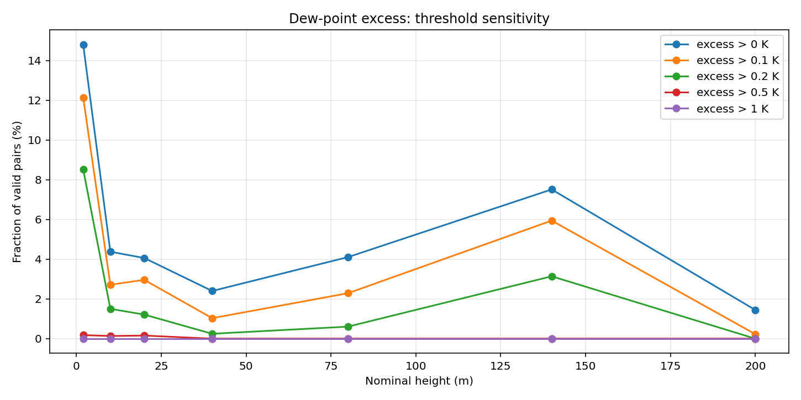

*Figure 1. October 2026 dew-point excess threshold sensitivity.*

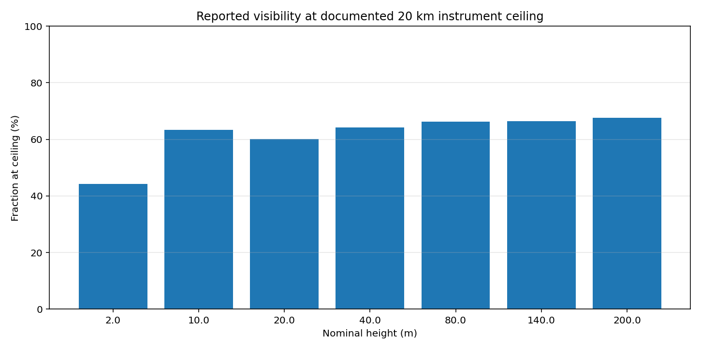

*Figure 2. Recorded visibility ceiling by nominal measurement level.*

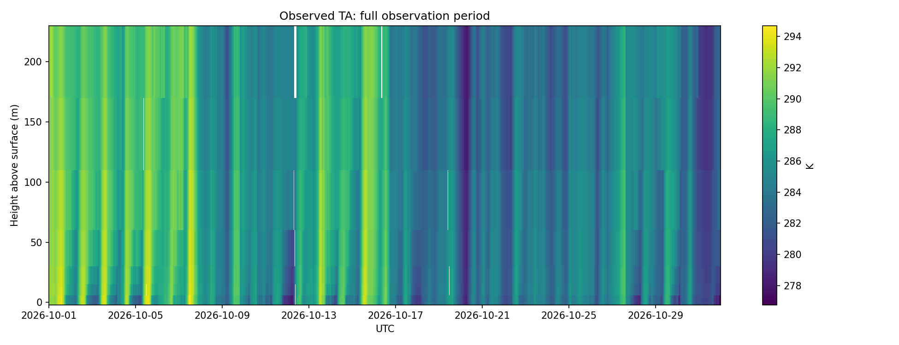

*Figure 3. Observed October temperature record; missing values remain missing.*

## 7. Annual observational study (6G.10)

All twelve source months of 2025 were processed: 52,560 expected and observed timestamps. The seven-level grid provides 367,920 possible records per variable, but actual completeness varies.

| variable   |      n |   expected_intervals |   Coverage (%) |
|:-----------|-------:|---------------------:|---------------:|
| Q          | 347173 |               367920 |         94.361 |
| TA         | 351483 |               367920 |         95.532 |
| TD         | 350842 |               367920 |         95.358 |
| ZMA        | 247478 |               367920 |         67.264 |

Observed 10 m seasonal medians (temperature in °C, specific humidity in g/kg):

| period   |     Q |     TA |
|:---------|------:|-------:|
| DJF      | 4.322 |  4.420 |
| MAM      | 5.218 | 11.170 |
| JJA      | 9.626 | 18.430 |
| SON      | 7.284 | 12.270 |

The DJF group combines January, February and December 2025; it is not a contiguous winter. Monthly visibility outages and summer temperature gaps are structured by measurement level. In particular, the July 140–200 m and 2–200 m comparisons each have just 71 valid pairs of 4,464 possible. A low inversion count during such a gap cannot establish a low physical occurrence rate.

| period   |   lower_m |   upper_m |   valid_pairs |   expected_intervals |   Coverage (%) |
|:---------|----------:|----------:|--------------:|---------------------:|---------------:|
| 2025-06  |     2.000 |    10.000 |          3212 |                 4320 |         74.352 |
| 2025-06  |    10.000 |    20.000 |          3217 |                 4320 |         74.468 |
| 2025-06  |    20.000 |    40.000 |          3221 |                 4320 |         74.560 |
| 2025-06  |    80.000 |   140.000 |          3730 |                 4320 |         86.343 |
| 2025-06  |   140.000 |   200.000 |          1377 |                 4320 |         31.875 |
| 2025-06  |     2.000 |   200.000 |           434 |                 4320 |         10.046 |
| 2025-07  |   140.000 |   200.000 |            71 |                 4464 |          1.591 |
| 2025-07  |     2.000 |   200.000 |            71 |                 4464 |          1.591 |
| 2025-08  |    20.000 |    40.000 |          1583 |                 4464 |         35.461 |
| 2025-08  |    40.000 |    80.000 |          1146 |                 4464 |         25.672 |

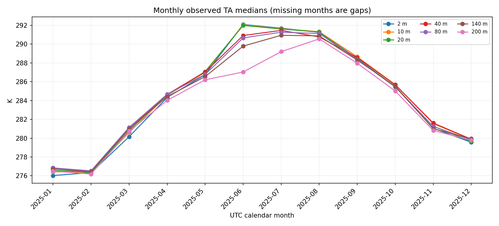

*Figure 4. Annual observed temperature distributions.*

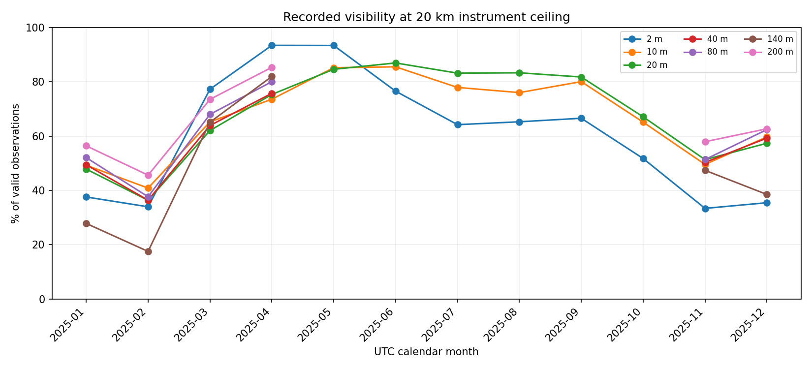

*Figure 5. Visibility-ceiling occurrence by month.*

## 8. Interannual and historical comparison (6G.11–12)

Across the 19 acquired Cabauw months, the exported source inventory reports 83,232 observed timestamps and no missing grid intervals. The API inventory snapshot lists 40 monthly files; 21 were not downloaded. The seven matching months of 2025 and 2026 are February, March, April, May, July, August and October. The 19 acquired files do not represent a continuous two-year record. The unavailable-in-snapshot months must not be interpreted as absence of measurements in the original archive.

Matched monthly median differences at nominal 10 m (2026 minus 2025):

|   calendar_month |      Q |     TA |     TD |
|-----------------:|-------:|-------:|-------:|
|            2.000 |  1.156 |  2.520 |  3.280 |
|            3.000 |  0.773 |  0.770 |  2.315 |
|            4.000 | -0.824 | -0.910 | -2.130 |
|            5.000 |  0.699 |  0.020 |  1.620 |
|            7.000 | -0.172 |  0.730 | -0.230 |
|            8.000 | -0.029 |  0.760 | -0.050 |
|           10.000 | -0.112 | -0.370 | -0.110 |

Historical instrumentation changed in 2010 and humidity-sensor design improved in 2014 [2]. The 2006 files are not interchangeable with later observations without metadata review. The historical inventory is retained but no historical trend is inferred.

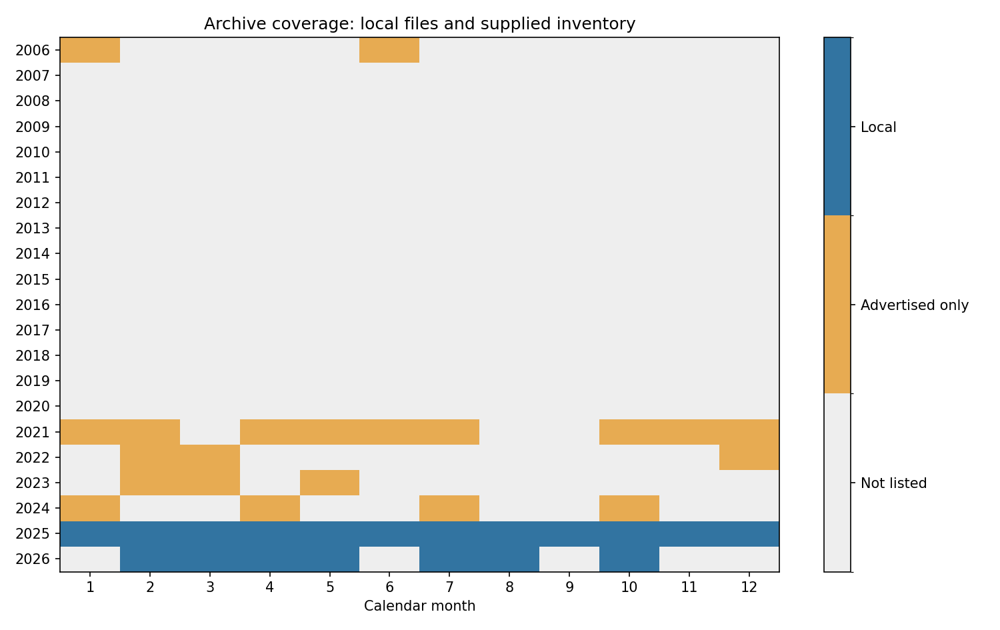

*Figure 6. Local and listed archive coverage. Grey denotes not listed in the supplied snapshot, including months outside the observed period.*

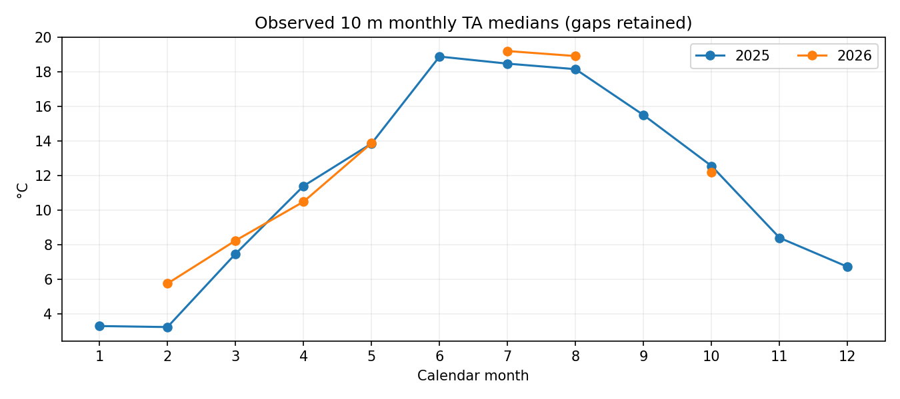

*Figure 7. Matched-period air temperature; absent months remain gaps.*

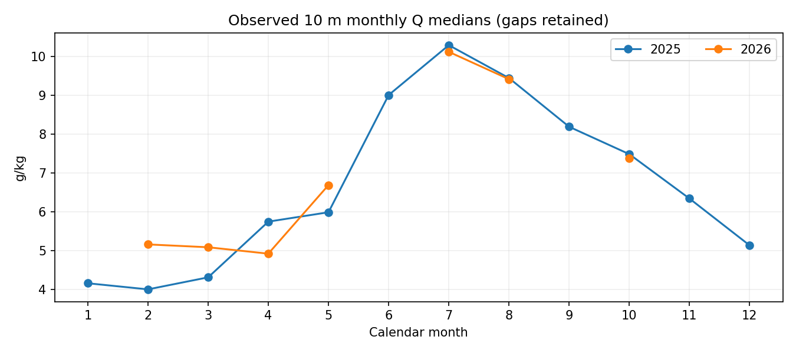

*Figure 8. Matched-period specific humidity.*

## 9. Independent surface observations (6G.13–15)

The two DWD stations and Cabauw supply 157,680 station-time slots for 2025; 72 monthly site-variable summary rows were generated. Both DWD archives contain 52,560 records with QN=3. The code is retained as provider metadata, not interpreted as a per-record error bound. No independent tall-tower profiles were acquired.

| site                 | variable   |     n |   expected |   coverage_pct |
|:---------------------|:-----------|------:|-----------:|---------------:|
| Cabauw               | TA         | 51174 |      52560 |         97.363 |
| Cabauw               | TD         | 51154 |      52560 |         97.325 |
| Hamburg-Fuhlsbuettel | TA         | 52195 |      52560 |         99.306 |
| Hamburg-Fuhlsbuettel | TD         | 52036 |      52560 |         99.003 |
| Lindenberg           | TA         | 52524 |      52560 |         99.932 |
| Lindenberg           | TD         | 52524 |      52560 |         99.932 |

The two Cabauw June surface rows have 74.54% coverage and fail the 90% screen. Monthly near-surface median temperatures follow a common seasonal cycle. Cabauw has the highest observed monthly median dew point in every month, including the flagged June observation; conclusions for that month are conditional. Site exposure, sampling and sensor methods may confound the comparisons. They do not isolate maritime or continental effects.

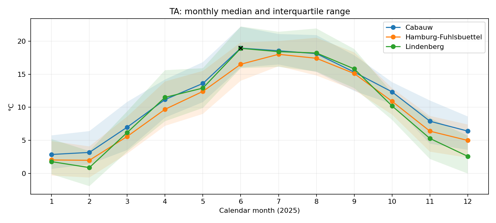

*Figure 9. Air-temperature medians and interquartile ranges.*

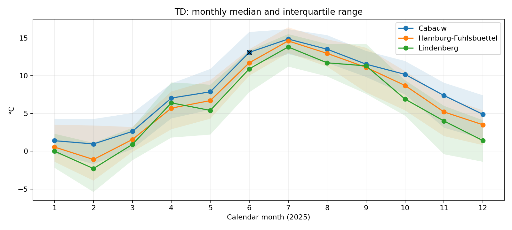

*Figure 10. Dew-point medians and interquartile ranges.*

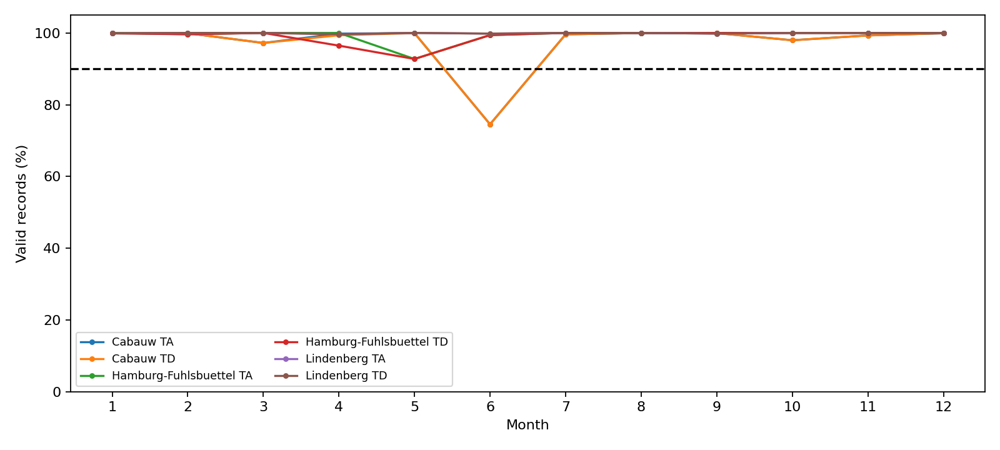

*Figure 11. Monthly coverage, with 90% screening threshold.*

## 10. Temporal dependence (6G.17)

The daily analysis includes Hamburg and Lindenberg only; it does not process Cabauw raw daily records. The 1,460 site-variable-day rows include ineligible days with missing medians. The actual valid daily counts are:

| site                 | variable   |   days |   eligible |
|:---------------------|:-----------|-------:|-----------:|
| Hamburg-Fuhlsbuettel | TA         |    365 |        358 |
| Hamburg-Fuhlsbuettel | TD         |    365 |        354 |
| Lindenberg           | TA         |    365 |        364 |
| Lindenberg           | TD         |    365 |        364 |

The following pairwise correlations were independently recomputed from the uploaded daily CSV, preserving date gaps. All 40 agree with the reported results to numerical precision.

| site                 | variable   |   lag_days |   month_centered |   raw |
|:---------------------|:-----------|-----------:|-----------------:|------:|
| Hamburg-Fuhlsbuettel | TA         |          1 |            0.674 | 0.930 |
| Hamburg-Fuhlsbuettel | TA         |          2 |            0.375 | 0.866 |
| Hamburg-Fuhlsbuettel | TA         |          3 |            0.206 | 0.829 |
| Hamburg-Fuhlsbuettel | TA         |          7 |           -0.130 | 0.776 |
| Hamburg-Fuhlsbuettel | TA         |         14 |           -0.171 | 0.760 |
| Hamburg-Fuhlsbuettel | TD         |          1 |            0.697 | 0.910 |
| Hamburg-Fuhlsbuettel | TD         |          2 |            0.437 | 0.833 |
| Hamburg-Fuhlsbuettel | TD         |          3 |            0.223 | 0.769 |
| Hamburg-Fuhlsbuettel | TD         |          7 |           -0.099 | 0.693 |
| Hamburg-Fuhlsbuettel | TD         |         14 |           -0.262 | 0.634 |
| Lindenberg           | TA         |          1 |            0.700 | 0.940 |
| Lindenberg           | TA         |          2 |            0.393 | 0.875 |
| Lindenberg           | TA         |          3 |            0.270 | 0.849 |
| Lindenberg           | TA         |          7 |           -0.102 | 0.779 |
| Lindenberg           | TA         |         14 |           -0.196 | 0.743 |
| Lindenberg           | TD         |          1 |            0.737 | 0.911 |
| Lindenberg           | TD         |          2 |            0.474 | 0.821 |
| Lindenberg           | TD         |          3 |            0.277 | 0.753 |
| Lindenberg           | TD         |          7 |           -0.132 | 0.628 |
| Lindenberg           | TD         |         14 |           -0.217 | 0.578 |

High correlations in the raw series include a substantial seasonal component. Month-centering reduces long-lag correlations, but negative values after centering may partly result from the centering operation; they do not demonstrate a physical reversal or a predictive relationship.

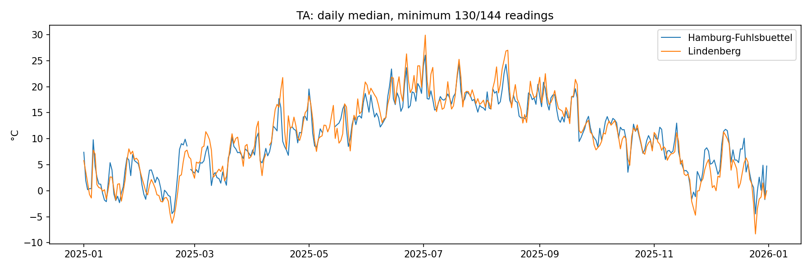

*Figure 12. Daily observed air-temperature medians; gaps represent failed coverage.*

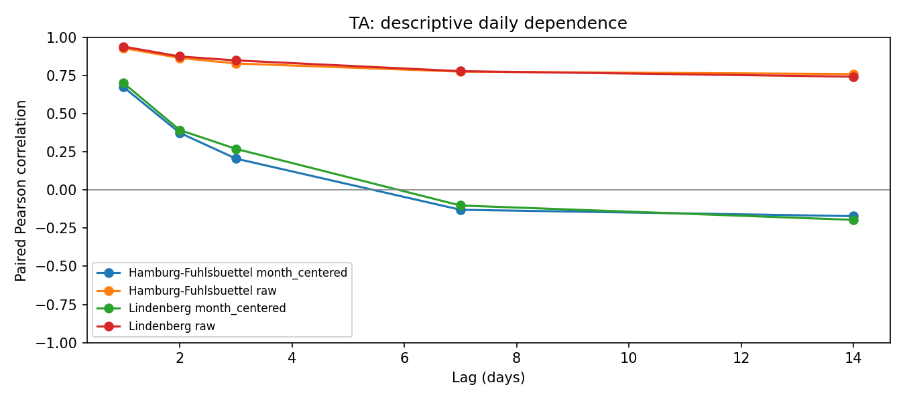

*Figure 13. Raw and month-centered daily temperature correlations.*

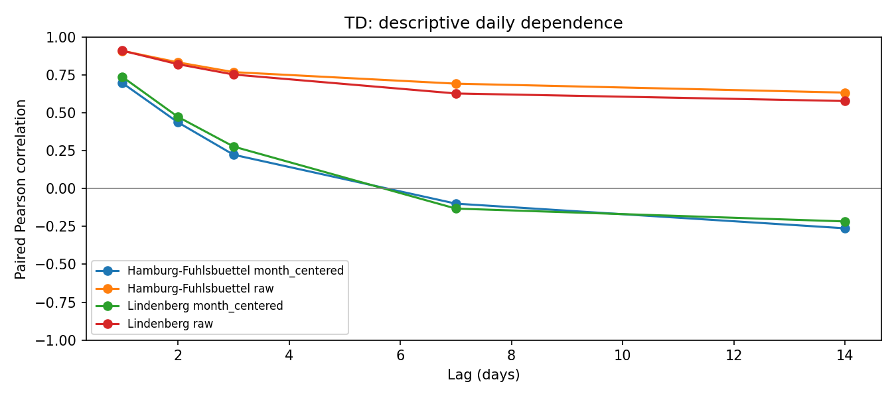

*Figure 14. Raw and month-centered daily dew-point correlations.*

## 11. Missing-data uncertainty (6G.18)

The 48 DWD monthly median bounds are internally ordered and contain their reported observed medians. The following are the nonzero-width intervals (°C):

| site                 | variable   |   month |    n |   expected |   observed_median |   lower |   upper |   width |
|:---------------------|:-----------|--------:|-----:|-----------:|------------------:|--------:|--------:|--------:|
| Hamburg-Fuhlsbuettel | TA         |       5 | 4140 |       4464 |            12.400 |  11.900 |  13.000 |   1.100 |
| Hamburg-Fuhlsbuettel | TD         |       1 | 4458 |       4464 |             0.550 |   0.500 |   0.600 |   0.100 |
| Hamburg-Fuhlsbuettel | TD         |       4 | 4167 |       4320 |             5.700 |   5.500 |   6.050 |   0.550 |
| Hamburg-Fuhlsbuettel | TD         |       5 | 4140 |       4464 |             6.700 |   6.400 |   7.100 |   0.700 |
| Lindenberg           | TA         |       4 | 4305 |       4320 |            11.500 |  11.500 |  11.600 |   0.100 |
| Lindenberg           | TA         |       9 | 4312 |       4320 |            15.800 |  15.700 |  15.800 |   0.100 |

These bounds quantify the sensitivity of sample medians to unknown missing values, not sampling uncertainty or calibration error. Cabauw bounds were not calculated from raw daily measurements. The distinction matters because a coverage threshold alone cannot establish missing-at-random assumptions or representativeness.

## 12. Statistical robustness (6G.19)

The 24 coverage-threshold calculations were independently recomputed from the uploaded monthly CSV. The table below gives equal-weight mean differences of monthly medians in °C, with numbers of retained months in parentheses.

| variable   | site_a               | site_b               | 0.75        | 0.9         | 0.95        | 0.99        |
|:-----------|:---------------------|:---------------------|:------------|:------------|:------------|:------------|
| TA         | Cabauw               | Hamburg-Fuhlsbuettel | +1.080 (11) | +1.080 (11) | +1.067 (10) | +0.981 (8)  |
| TA         | Cabauw               | Lindenberg           | +1.148 (11) | +1.148 (11) | +1.148 (11) | +1.077 (9)  |
| TA         | Hamburg-Fuhlsbuettel | Lindenberg           | -0.137 (12) | -0.137 (12) | -0.105 (11) | -0.105 (11) |
| TD         | Cabauw               | Hamburg-Fuhlsbuettel | +1.155 (11) | +1.155 (11) | +1.155 (10) | +1.096 (7)  |
| TD         | Cabauw               | Lindenberg           | +2.060 (11) | +2.060 (11) | +2.060 (11) | +1.963 (9)  |
| TD         | Hamburg-Fuhlsbuettel | Lindenberg           | +0.896 (12) | +0.896 (12) | +0.859 (11) | +1.015 (10) |

Cabauw June is excluded even at the lowest 75% threshold, so the analysis does not test whether including June changes the result. Month selection changes across stricter cutoffs. The omitted-month analysis uses the common months meeting the 90% screen; all 68 exported calculations were independently recomputed.

| variable   | site_a               | site_b               |    min |   max |
|:-----------|:---------------------|:---------------------|-------:|------:|
| TA         | Cabauw               | Hamburg-Fuhlsbuettel |  1.037 | 1.166 |
| TA         | Cabauw               | Lindenberg           |  0.881 | 1.311 |
| TA         | Hamburg-Fuhlsbuettel | Lindenberg           | -0.368 | 0.068 |
| TD         | Cabauw               | Hamburg-Fuhlsbuettel |  1.053 | 1.246 |
| TD         | Cabauw               | Lindenberg           |  1.918 | 2.244 |
| TD         | Hamburg-Fuhlsbuettel | Lindenberg           |  0.786 | 1.041 |

Cabauw’s positive differences persist in the evaluated sensitivity scenarios. The Hamburg–Lindenberg temperature difference changes sign under month omission. These are descriptive robustness checks, not confidence intervals or significance tests.

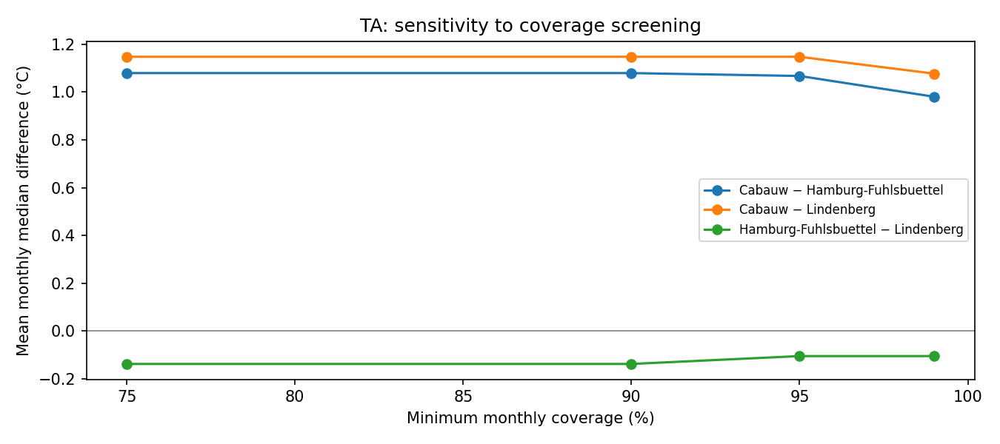

*Figure 15. Air-temperature sensitivity to coverage screening.*

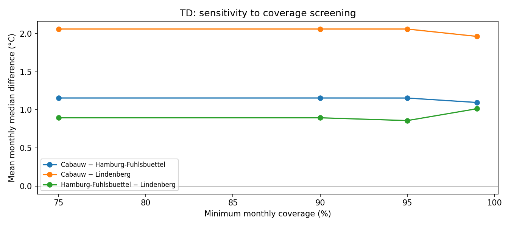

*Figure 16. Dew-point sensitivity to coverage screening.*

## 13. Verification and reproducibility

The closing audit used the uploaded derived result tables, figures, and JSON summaries, not the original 19 KNMI and two DWD source files. The raw-file hashes recorded by earlier executions are retained in the evidence JSONs; they were not independently recomputed from absent raw sources. The two DWD archive hashes are identical between the Batch 12 and Batch 13 manifests. The earlier October KNMI hash is consistent across the native and thermodynamic reports. Software-package test results previously reported were separate from this closing audit; the original packages are not retested here.

| Closing audit test | Result |
|---|---|
| Expected monthly surface rows and unique keys | 72/72, no duplicates |
| Monthly quantile ordering and coverage | 72/72 consistent |
| Daily records, unique keys, coverage and screening | 1,460/1,460 consistent |
| Lagged Pearson correlations and pair counts | 40/40 recomputed |
| Coverage sensitivity values and month counts | 24/24 recomputed |
| Omitted-month values and month counts | 68/68 recomputed |
| Median bound containment | 48/48; raw order statistics not rechecked |

The evidence directory preserves the exported observational tables and provenance summaries with stage-number prefixes. The Stage 7 variable-completeness table is restricted to thermodynamic and visibility fields for this report. Figures are original exported PNGs. A SHA-256 manifest covers the files in the final archive, excluding the manifest itself. It establishes archive integrity, not scientific validity. The raw observations and earlier scripts remain separate from this report.

## 14. Limitations and closure decision

The empirical study is limited to selected European stations and observation periods. One complete calendar year does not establish a climate normal or a multi-year trend. Unlisted months represent inventory availability, not proof of missing historical observations. Different instruments, exposures and sampling windows restrict cross-provider comparability. Structured gaps affect particular periods and levels; 90% coverage is a screening convention rather than proof of representativeness. Ten-minute records and daily summaries do not resolve faster atmospheric behavior. Temperature inversions are descriptive and not a complete stability diagnosis; independent vertical-profile comparison, independent instrument calibration and formal inferential uncertainty remain unestablished.

The work does not establish operational prediction accuracy, simulation fidelity, or the performance of a UAV payload system. These outcomes require independent evidence and cannot be inferred from this descriptive study. No universal atmospheric model ranking or application-specific parameter recommendation is made here.

## 15. Conclusions

The observational phase established a reproducible basis for understanding the quality and variability of the selected meteorological records. Its strongest findings concern structured missingness, documented measurement-range limitations, the relationship between recorded low visibility and positive dew-point discrepancy, recurring annual temperature and moisture patterns, and the distinction between seasonal correlation and shorter-term dependence. The cross-site comparison demonstrates descriptive geographical differences while preserving the limitations of nonidentical observation methods. The sensitivity analyses identify conclusions that persist under specific screening choices and conclusions that depend on which months are retained.

Stage 6G can be closed as a bounded observational study. Earlier theoretical work and model experiments remain distinct from empirical validation. Further climatological expansion is not necessary for this closing report; unresolved questions are retained rather than marked as complete.

## References

1. KNMI. *Meteo profiles – validated tower profiles of wind, dew point, temperature and visibility at 10 minute interval at Cabauw*. Dataset `cesar_tower_meteo_lb1_t10`, v1.3, 2025. [Dataset](https://dataplatform.knmi.nl/dataset/cesar-tower-meteo-lb1-t10-v1-3); [access documentation](https://dataplatform.knmi.nl/dataset/access/cesar-tower-meteo-lb1-t10-v1-3). CC BY 4.0.
2. Bosveld, F. C. (2020). *The Cabauw In-situ Observational Program 2000–Present: Instruments, Calibrations and Set-up*. KNMI Technical Report TR-384, sections 7 and 9. [Report](https://cdn.knmi.nl/knmi/pdf/bibliotheek/knmipubTR/TR384.pdf).
3. Deutscher Wetterdienst (DWD), Climate Data Center. *Historical ten-minute air-temperature observations, Germany*. [Archive](https://opendata.dwd.de/climate_environment/CDC/observations_germany/climate/10_minutes/air_temperature/historical/). Stations 01975 and 03015, files spanning 2020–2025; 2025 subset analyzed. [Variable definitions as indexed by Wetterdienst](https://wetterdienst.readthedocs.io/en/latest/data/provider/dwd/observation/10_minutes.html).
4. NIST/SEMATECH. *e-Handbook of Statistical Methods*, section 1.3.5.12, Autocorrelation. [Handbook](https://itl.nist.gov/div898/handbook/eda/section3/eda35c.htm).

## Appendix A. Evidence and figures

The following original observations-derived tables and figures are included in the accompanying archive. Stage prefixes disambiguate repeated filenames. All figure files are retained, including full-period and zoomed views where provided. Tables preserve original precision; rounded values in the report are for readability.

### Evidence

- [07_daily_thermodynamic_summary.csv](evidence/07_daily_thermodynamic_summary.csv)
- [07_native_audit.json](evidence/07_native_audit.json)
- [07_timestamp_audit.csv](evidence/07_timestamp_audit.csv)
- [07_variable_completeness.csv](evidence/07_variable_completeness.csv)
- [08_climatology_summary.json](evidence/08_climatology_summary.json)
- [08_daily_temperature_difference.csv](evidence/08_daily_temperature_difference.csv)
- [08_diurnal_summary.csv](evidence/08_diurnal_summary.csv)
- [08_inversion_events.csv](evidence/08_inversion_events.csv)
- [08_inversion_summary.csv](evidence/08_inversion_summary.csv)
- [08_time_mapping.csv](evidence/08_time_mapping.csv)
- [08_visibility_ceiling_diagnostic.csv](evidence/08_visibility_ceiling_diagnostic.csv)
- [09_derived_humidity_coverage.csv](evidence/09_derived_humidity_coverage.csv)
- [09_dewpoint_by_visibility.csv](evidence/09_dewpoint_by_visibility.csv)
- [09_dewpoint_thresholds.csv](evidence/09_dewpoint_thresholds.csv)
- [09_measurement_consistency_summary.json](evidence/09_measurement_consistency_summary.json)
- [09_positive_excess_records.csv](evidence/09_positive_excess_records.csv)
- [09_visibility_ceiling.csv](evidence/09_visibility_ceiling.csv)
- [10_monthly_statistics.csv](evidence/10_monthly_statistics.csv)
- [10_monthly_temperature_differences.csv](evidence/10_monthly_temperature_differences.csv)
- [10_seasonal_statistics.csv](evidence/10_seasonal_statistics.csv)
- [10_seasonal_summary.json](evidence/10_seasonal_summary.json)
- [10_seasonal_temperature_differences.csv](evidence/10_seasonal_temperature_differences.csv)
- [11_historical_inventory.csv](evidence/11_historical_inventory.csv)
- [11_matched_2025_2026.csv](evidence/11_matched_2025_2026.csv)
- [11_monthly_surface_statistics.csv](evidence/11_monthly_surface_statistics.csv)
- [11_summary.json](evidence/11_summary.json)
- [12_existing_stratification_coverage.csv](evidence/12_existing_stratification_coverage.csv)
- [12_monthly_surface_comparison.csv](evidence/12_monthly_surface_comparison.csv)
- [12_summary.json](evidence/12_summary.json)
- [13_coverage_sensitivity.csv](evidence/13_coverage_sensitivity.csv)
- [13_daily_lag_correlations.csv](evidence/13_daily_lag_correlations.csv)
- [13_daily_medians.csv](evidence/13_daily_medians.csv)
- [13_leave_one_month_out.csv](evidence/13_leave_one_month_out.csv)
- [13_median_missingness_bounds.csv](evidence/13_median_missingness_bounds.csv)
- [13_monthly_missingness.csv](evidence/13_monthly_missingness.csv)
- [13_summary.json](evidence/13_summary.json)

### Figures

- [07_daily_Q.png](figures/07_daily_Q.png)
- [07_daily_TA.png](figures/07_daily_TA.png)
- [07_daily_TD.png](figures/07_daily_TD.png)
- [07_daily_ZMA.png](figures/07_daily_ZMA.png)
- [08_Q_diurnal.png](figures/08_Q_diurnal.png)
- [08_Q_time_height.png](figures/08_Q_time_height.png)
- [08_TA_diurnal.png](figures/08_TA_diurnal.png)
- [08_TA_time_height.png](figures/08_TA_time_height.png)
- [08_TD_time_height.png](figures/08_TD_time_height.png)
- [08_ZMA_time_height.png](figures/08_ZMA_time_height.png)
- [08_dewpoint_depression_K_diurnal.png](figures/08_dewpoint_depression_K_diurnal.png)
- [08_temperature_difference_first_72h.png](figures/08_temperature_difference_first_72h.png)
- [08_temperature_difference_full.png](figures/08_temperature_difference_full.png)
- [09_01_dewpoint_thresholds.png](figures/09_01_dewpoint_thresholds.png)
- [09_02_daily_dewpoint_excess.png](figures/09_02_daily_dewpoint_excess.png)
- [09_03_excess_first_72h.png](figures/09_03_excess_first_72h.png)
- [09_03_excess_full.png](figures/09_03_excess_full.png)
- [09_04_visibility_ceiling.png](figures/09_04_visibility_ceiling.png)
- [10_01_monthly_temperature.png](figures/10_01_monthly_temperature.png)
- [10_02_monthly_humidity.png](figures/10_02_monthly_humidity.png)
- [10_03_monthly_temperature_differences.png](figures/10_03_monthly_temperature_differences.png)
- [10_04_monthly_visibility_ceiling.png](figures/10_04_monthly_visibility_ceiling.png)
- [10_05_monthly_dewpoint_excess.png](figures/10_05_monthly_dewpoint_excess.png)
- [11_01_archive_coverage.png](figures/11_01_archive_coverage.png)
- [11_02_Q_monthly.png](figures/11_02_Q_monthly.png)
- [11_02_TA_monthly.png](figures/11_02_TA_monthly.png)
- [11_03_matched_temperature_difference.png](figures/11_03_matched_temperature_difference.png)
- [11_04_temperature_coverage.png](figures/11_04_temperature_coverage.png)
- [12_TA_monthly.png](figures/12_TA_monthly.png)
- [12_TD_monthly.png](figures/12_TD_monthly.png)
- [12_coverage.png](figures/12_coverage.png)
- [13_coverage_TA.png](figures/13_coverage_TA.png)
- [13_coverage_TD.png](figures/13_coverage_TD.png)
- [13_daily_TA.png](figures/13_daily_TA.png)
- [13_daily_TD.png](figures/13_daily_TD.png)
- [13_lags_TA.png](figures/13_lags_TA.png)
- [13_lags_TD.png](figures/13_lags_TD.png)
- [13_sensitivity_TA.png](figures/13_sensitivity_TA.png)
- [13_sensitivity_TD.png](figures/13_sensitivity_TD.png)
